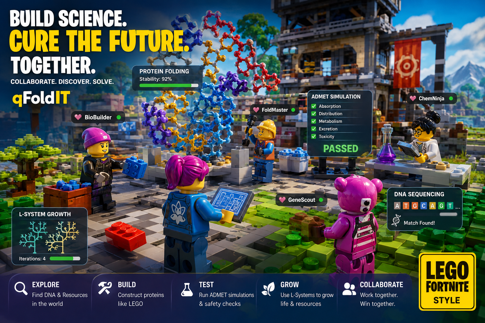

# Epic AI MEGAJAM 2026

<p align="center">
  
</p>

# qFoldIT / Foldnite

**From scientific task to standardized, executable and independently reviewable interactive mission.**

qFoldIT develops the standards and technology behind **Foldnite** — a modular platform that transforms scientific and industrial objectives into interactive missions and engine-adaptable gameplay experiences.

A Foldnite level is not an arbitrary game map. It is the interactive execution layer of a governed scientific task.

## Three differentiated Foldnite modules

| Module | Purpose |
|---|---|
| **Scientific World & Assembly** | VBMA + SOS + SKG + SEM + UAG: scientific objects, knowledge, operations, spatial worlds and engine-neutral assembly |
| **Scientific Validation Fabric** | Claim-specific diagnostics, reconciliation, independent scientific assessment and evidence hand-off |
| **Popularization & Experience** | Pop culture, narrative, game design, characters, interaction, learning and science communication |

## Compiling science into interactive missions

The mission workflow connects a source objective to a controlled mission contract, standardized scientific objects, execution and experience design, and an engine-neutral runtime package.

```text
Objective → Mission Inception → Protocol Lock
         → Approved Mission Contract
         → Scientific World + Experience
         → Mission Compilation
         → Engine / Runtime Adapter
         → Interactive Mission
         → Candidate Submission
         → Independent Validation
         → Evidence-backed Delivery
```

The compiler is designed to preserve scientific identity, constraints and validation requirements while translating the approved task into an interactive level. The runtime presents the mission; it does not define scientific truth.

## Standards make the platform interoperable

- **SOS / SKG / SEM** standardize scientific objects, knowledge relationships and execution semantics.
- **VBMA / UAG** provide a common basis for spatial world construction and engine-neutral assembly.
- **FIC 1.0** defines the shared interoperability contract for every Foldnite block.
- **QSIS Core 1.0** standardizes scientific capabilities, jobs, data, provenance and provider authority across Scientific MCPs and other scientific interfaces.
- **Scientific Action Envelope and Evidence standards** bind consequential actions to mission context and keep validation evidence separate from provider output.
- **Runtime, validation and release profiles** define how adapters and scientific claims are assessed.

MCP is a transport and tool-discovery protocol. QSIS supplies the scientific interoperability semantics. This prevents each lab, model provider or scientific tool from becoming a bespoke integration that only one agent or application understands.

The standards are internal qFoldIT requirements, open to implementation and review; they are not presented as formal external standards-body ratification. Draft specifications and implementation-specific qualifications are labelled in the [UAG-SOS registry](https://github.com/qfoldit/UAG-SOS).

## Scientific validation is separate from execution

A successful computation is not automatically a valid scientific result. Foldnite separates:

**Execution → Independent validation → Evidence publication → Customer acceptance.**

The validator must be appropriate to the scientific claim. The component that generates a candidate cannot approve its own result. The evidence boundary verifies the mission, validator authority, artifact identity and provenance before issuing a trusted record.

## Platform services

Mission Control and compilation, Scientific MCP Mesh, Human–AI Collective Work, Mission Runtime and Toolbelts, Evidence & Provenance, Enterprise Governance, and Standards & Conformance support the three differentiated product modules as one interoperable system.

## Explore the platform

- [Mission and control plane — UEFN-QFOLDIT](https://github.com/qfoldit/UEFN-QFOLDIT)
- [Standards, schemas and conformance — UAG-SOS](https://github.com/qfoldit/UAG-SOS)
- [Scientific environments and level production — RANDOM42](https://github.com/qfoldit/RANDOM42)
- [Enterprise governance — CORPORATE_APP](https://github.com/qfoldit/CORPORATE_APP)
- [Scientific validation boundary — OPENSTRUCTURE](https://github.com/qfoldit/OPENSTRUCTURE)

**qFoldIT standardizes the scientific workflow. Foldnite compiles it into an interactive mission. Independent validation keeps the result accountable.**
